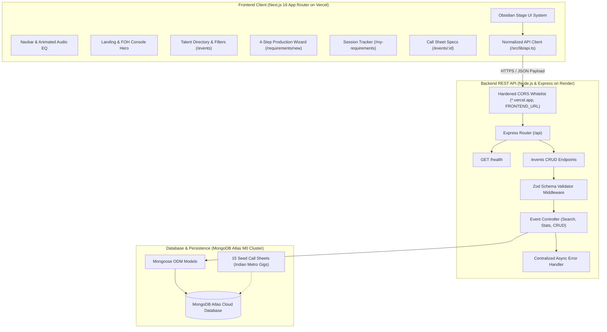
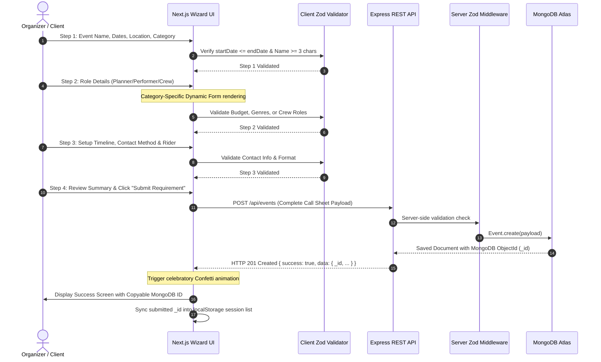
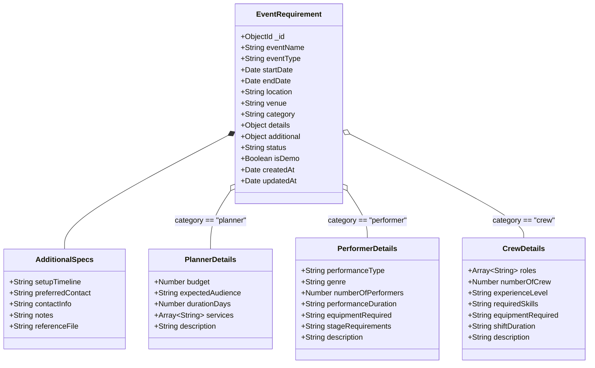

# GoPratle — Event Requirement Posting & Production Talent Platform

[](https://nextjs.org/)
[](https://react.dev/)
[](https://nodejs.org/)
[](https://expressjs.com/)
[](https://www.mongodb.com/)
[](https://tailwindcss.com/)
[](https://www.typescriptlang.org/)
[](https://vitest.dev/)
[](#2-design-system--obsidian-stage-aesthetic)

**GoPratle** is an event requirement posting and production talent platform developed for the **Full-Stack Developer Intern** assignment. It connects event organizers with event planners, live performers, and technical stage crew members across major Indian metropolitan cities (Bengaluru, Hyderabad, Mumbai, Delhi).

Engineered with a human-crafted **Obsidian Stage & Solar Amber** aesthetic, GoPratle rejects generic AI boilerplate in favor of a tactile live-concert console feel: animated soundboard audio visualizers, monospace production telemetry, call-sheet ticket stubs, and an interactive 4-step wizard backed by a validated Node.js/Express REST API and MongoDB Atlas.

---

## 📑 Table of Contents

1. [Architecture & System Design](#1-architecture--system-design)
2. [Design System & "Obsidian Stage" Aesthetic](#2-design-system--obsidian-stage-aesthetic)
3. [Technology Stack](#3-technology-stack)
4. [Key Features & User Journeys](#4-key-features--user-journeys)
5. [Project Structure](#5-project-structure)
6. [Getting Started (Local Development)](#6-getting-started-local-development)
7. [Environment Variables](#7-environment-variables)
8. [Database Schema & Seed Data](#8-database-schema--seed-data)
9. [REST API Documentation](#9-rest-api-documentation)
10. [Automated Testing (27 Tests)](#10-automated-testing-27-tests)
11. [Production Deployment (Render, Vercel & Atlas)](#11-production-deployment-render-vercel--atlas)
12. [Limitations & Future Roadmap](#12-limitations--future-roadmap)

---

## 1. Architecture & System Design

GoPratle is designed as a decoupled, production-ready full-stack application following clean architectural separation of concerns.

### 🌐 System Architecture Diagram



---

### 🔄 Interactive 4-Step Wizard & Data Flow Sequence



---

### 🗄️ Unified Polymorphic Schema Architecture



---

## 2. Design System & "Obsidian Stage" Aesthetic

Rather than relying on generic AI purple gradients and sterile SaaS templates, GoPratle was crafted around the tactile, energetic world of **live event production**:

- **Obsidian Stage Pitch (`#08090C`)**: Deep, low-fatigue architectural dark canvas paired with an analog micro-grid texture.
- **Solar Amber (`#F59E0B`)**: High-voltage tungsten spotlight accent inspired by stage lights, analog VU-meters, and VIP badges.
- **Live Soundboard Audio Visualizer**: A 4-bar animated equalizer in the navigation bar showing real-time telemetry.
- **Production Telemetry Strips**: Monospace airport city tags (`BLR • BOM • HYD • DEL`) and call-sheet IDs.
- **Departmental Visual Identities**:
  - **Event Planners**: Tungsten Gold (`#F59E0B`) — executive production, budgets, and venue scale.
  - **Performers**: Stage Vermilion (`#FF385C`) — live bands, artists, DJs, and acoustic frequency.
  - **Crew & Tech**: Cyber Emerald (`#10B981`) — soundboards, DMX lighting cables, and audio meters in the green.

---

## 3. Technology Stack

| Layer | Technologies | Role in Platform |
| :--- | :--- | :--- |
| **Frontend Framework** | **Next.js 16 (App Router)** | Server & Client components, file-system routing, streaming |
| **Language** | **TypeScript 5.x** | End-to-end type safety, interfaces, strict mode |
| **Styling & Design** | **Tailwind CSS v4** | Modern CSS variables, responsive design, dark mode |
| **Icons & Motion** | **Lucide React & Motion** | Micro-interactions, icons, feedback states |
| **Form Management** | **React Hook Form & Zod** | Controlled wizard state, step-by-step schema validation |
| **Celebration** | **Canvas-Confetti** | Rewarding visual feedback upon MongoDB record creation |
| **Backend Framework** | **Node.js 24 + Express 4.21** | Modular REST API, route handlers, error middleware |
| **Database & ODM** | **MongoDB Atlas + Mongoose 8.9** | Cloud document database, flexible polymorphic schema |
| **Testing** | **Vitest 3 + Supertest + RTL** | 27 automated unit tests covering frontend and backend |
| **Deployment** | **Vercel + Render + Atlas** | Zero-downtime static and serverless cloud topology |

---

## 4. Key Features & User Journeys

### 1. Interactive 4-Step Requirement Wizard (`/requirements/new`)
- **Step 1: Event Basics**: Title, event type selector, start & end date pickers with logical validation (`endDate >= startDate`), Indian city selector with quick-fill tags, and 3 department cards.
- **Step 2: Department-Specific Parameters**:
  - *Planner*: Numeric INR budget, expected audience dropdown, duration in days, multi-select service tags.
  - *Performer*: Act type, genre/style, number of performers, performance duration, equipment needed, and stage requirements.
  - *Crew*: Multi-role checkboxes (Sound, Lighting, Stage Manager, Camera, Rigging), team size, experience level, and required technical skills.
- **Step 3: Logistics & Contact Protocol**: Setup timeline, contact method selector (Email, Phone, WhatsApp) with contextual placeholder formatting, and optional tech rider upload.
- **Step 4: Review & Live Submission**: Clean summary cards with inline "Edit" jump links, anti-double-click loading states, and live POST to MongoDB.
- **Celebration Confirmation**: Live confetti explosion displaying event title, category badge, and actual **MongoDB Record ID** with one-click copy.

### 2. Talent & Call Sheet Directory (`/events`)
- **Live Search**: Instant keyword search across title, venue, city, and descriptions.
- **Dynamic Count Filter Pills**: Real-time count badges reflecting live database metrics (`All (16)`, `Planner (6)`, `Performer (6)`, `Crew (4)`).
- **Format Filter**: Filter by Cultural, Music, Corporate, Wedding, Sports, or Educational events.

### 3. Dynamic Requirement Details (`/events/:id`)
- Comprehensive single call sheet view with full specs, equipment requirements, and schedule timeline.
- **Organizer Contact Box**: Direct mailto, WhatsApp, or phone links based on preferred contact method.
- **Actions**: One-click URL copy and a safe deletion modal with MongoDB removal.

### 4. Local Session Requirements Tracker (`/my-requirements`)
- Demonstrates persistent user session state without requiring heavy authentication.
- Tracks requirements posted from the user's browser session (synced with MongoDB).
- Toggle between "My Browser Session" and "All Recent Requirements".

---

## 5. Project Structure

```text
GoPartle/
├── render.yaml                    # Render Web Service Blueprint specification
├── DEPLOYMENT.md                  # Complete cloud deployment guide
├── package.json                   # Root workspace scripts (dev, test, build, seed)
├── .gitignore                     # Root gitignore safeguarding secrets
│
├── backend/                       # Express REST API
│   ├── .env.example               # Backend environment template
│   ├── package.json               # Backend dependencies and scripts
│   ├── src/
│   │   ├── app.js                 # Express app configuration & hardened CORS
│   │   ├── server.js              # Port binding & MongoDB connection bootstrap
│   │   ├── config/
│   │   │   └── db.js              # Mongoose connection with Atlas retry timeout
│   │   ├── controllers/
│   │   │   └── eventController.js # CRUD, keyword search & filter breakdown logic
│   │   ├── data/
│   │   │   └── seedData.json      # 15 realistic Indian event call sheets
│   │   ├── middleware/
│   │   │   ├── errorHandler.js    # Global error & 404 handlers
│   │   │   └── validate.js        # Zod request validation middleware
│   │   ├── models/
│   │   │   └── Event.js           # Unified Mongoose event schema
│   │   ├── routes/
│   │   │   └── eventRoutes.js     # Health check and event endpoint routes
│   │   ├── scripts/
│   │   │   └── seed.js            # Idempotent remote & local database seeder
│   │   └── validators/
│   │       └── eventValidator.js  # Zod schemas with cross-field date validation
│   └── tests/
│       └── events.test.js         # 18 Supertest integration tests
│
└── frontend/                      # Next.js 16 App Router application
    ├── .env.example               # Frontend environment template
    ├── next.config.ts             # Next.js configuration (Unsplash image domains)
    ├── package.json               # Frontend dependencies and scripts
    ├── tsconfig.json              # TypeScript strict configuration
    ├── src/
    │   ├── app/
    │   │   ├── globals.css        # Obsidian Stage design system & audio animations
    │   │   ├── layout.tsx         # Permanent dark theme layout & Plus Jakarta Sans
    │   │   ├── page.tsx           # Homepage with FOH Console hero banner
    │   │   ├── events/
    │   │   │   ├── page.tsx       # Talent directory with live count filters
    │   │   │   └── [id]/page.tsx  # Dynamic call sheet details & contact actions
    │   │   ├── my-requirements/
    │   │   │   └── page.tsx       # Session requirements tracker
    │   │   └── requirements/
    │   │       └── new/page.tsx   # 4-step wizard with cross-step state preservation
    │   ├── components/
    │   │   ├── Navbar.tsx         # Header with live soundboard audio visualizer
    │   │   ├── Footer.tsx         # Footer with platform telemetry
    │   │   ├── EventCard.tsx      # Call-sheet ticket stub card
    │   │   ├── CategoryBadge.tsx  # Color-coded department badges
    │   │   ├── CategorySelector.tsx# 3-department interactive selection cards
    │   │   ├── Stepper.tsx        # Amber milestone progress bar
    │   │   ├── EmptyState.tsx     # Clean fallback states
    │   │   ├── LoadingSkeleton.tsx# Shimmer loading placeholders
    │   │   └── wizard/
    │   │       ├── Step1Basics.tsx
    │   │       ├── Step2Details.tsx
    │   │       ├── Step3Additional.tsx
    │   │       ├── Step4Review.tsx
    │   │       └── SuccessConfirmation.tsx # Confetti & MongoDB Record ID
    │   ├── lib/
    │   │   ├── api.ts             # Auto-normalizing REST API fetch client
    │   │   └── utils.ts           # Currency formatter (INR) & date range helper
    │   └── types/
    │       └── event.ts           # TypeScript interfaces for EventRequirement
    └── tests/
        ├── components.test.tsx    # 5 component unit tests
        └── wizard.test.tsx        # 4 interactive wizard form tests
```

---

## 6. Getting Started (Local Development)

### Prerequisites
- **Node.js**: v18.0.0 or higher
- **MongoDB**: Local MongoDB instance (`mongodb://127.0.0.1:27017`) or free MongoDB Atlas URI

### 1. Clone & Install Dependencies
```bash
git clone https://github.com/Abhishekchoudhary9622/GoPartle.git
cd GoPartle

# Install root, backend, and frontend dependencies
npm install
npm install --prefix backend
npm install --prefix frontend
```

### 2. Configure Environment Files
Copy the `.env.example` templates:
```bash
# Backend environment
cp backend/.env.example backend/.env

# Frontend environment
cp frontend/.env.example frontend/.env.local
```

### 3. Seed the Database
Populate your database with the 15 synthetic Indian event requirements:
```bash
npm run seed
```

### 4. Run Both Servers Concurrently
From the root directory:
```bash
# Terminal 1: Start Backend API (runs on http://localhost:5000)
npm run dev:backend

# Terminal 2: Start Frontend App (runs on http://localhost:3000)
npm run dev:frontend
```

Visit **`http://localhost:3000`** in your browser!

---

## 7. Environment Variables

### Backend (`backend/.env`)
```bash
PORT=5000
NODE_ENV=development
MONGODB_URI=mongodb://127.0.0.1:27017/gopratle
FRONTEND_URL=http://localhost:3000
```

### Frontend (`frontend/.env.local`)
```bash
NEXT_PUBLIC_API_URL=http://localhost:5000/api
```

---

## 8. Database Schema & Seed Data

The database includes **15 realistic event requirements** spanning Indian metro locations:
- **Planners (5 records)**: Bangalore Tech Summit, Big Fat Punjabi Wedding at Chattarpur, Sunburn Afterparty Goa, Hyderabad Fintech Conclave, Kala Ghoda Arts Gala.
- **Performers (5 records)**: Indie Rock Headline Band, Classical Carnatic Fusion Vocalist, Commercial Bollywood DJ, Standup Comedian, Kathak Classical Troupe.
- **Crew (5 records)**: FOH Digital Sound Engineer (Yamaha CL5), GrandMA3 Lighting Director, 4K Multi-Camera Broadcast Team, Stage Rigging & Truss Crew, High-Profile Security Team.

---

## 9. REST API Documentation

### Base URL: `http://localhost:5000/api` (or production Render URL)

| Method | Endpoint | Description | Request Body |
| :--- | :--- | :--- | :--- |
| `GET` | `/health` | Server uptime & DB connection check | None |
| `GET` | `/events` | List events with search, filters & stats | None (`?category=`, `?search=`) |
| `GET` | `/events/:id` | Fetch single event by 24-char ObjectId | None |
| `POST` | `/events` | Create new event requirement (validated via Zod) | `EventRequirement` JSON |
| `PUT` | `/events/:id` | Update existing event requirement | Partial `EventRequirement` JSON |
| `DELETE`| `/events/:id` | Remove event requirement | None |

#### Sample Success Response (`POST /api/events`):
```json
{
  "success": true,
  "message": "Event requirement created successfully",
  "data": {
    "_id": "67b3607afcdbf133aacbb6a0",
    "eventName": "Bengaluru Indie Fusion Fest 2026",
    "category": "performer",
    "status": "open",
    "createdAt": "2026-10-17T18:00:00.000Z"
  }
}
```

---

## 10. Automated Testing (27 Tests)

The repository features comprehensive automated test coverage across both frontend and backend:

```bash
# Run all 27 tests across the entire monorepo
npm test
```

### Test Breakdown:
- **Backend Supertest Suite (`backend/tests/events.test.js`)**: **18 Tests**
  - Database connectivity & health endpoint verification
  - Requirement creation for Planner, Performer, and Crew
  - Zod validation: rejection of missing required fields
  - Cross-field date constraint testing (`endDate < startDate` properly rejected)
  - Category-specific validation (missing budget, services, genre, crew skills)
  - Keyword search across titles, locations, and descriptions
  - Category filtering & breakdown statistic computation
  - Single event retrieval, 400 Bad Request on malformed ObjectId, 404 on missing record
  - PUT update and DELETE operations
- **Frontend Vitest Suite (`frontend/tests/`)**: **9 Tests**
  - `CategorySelector` 3-card click switching
  - `CategoryBadge` color classes and icons
  - `Stepper` active/completed step state rendering & navigation
  - Permanent dark mode DOM class persistence
  - `EventCard` metadata rendering and badges
  - Wizard Step 1 validation errors (short name, missing dates)
  - Client-side date logic validation
  - Category-specific field switching in Step 2
  - Submission confirmation screen displaying real MongoDB Record ID

---

## 11. Production Deployment (Render, Vercel & Atlas)

GoPratle is 100% cloud-ready. Refer to [`DEPLOYMENT.md`](./DEPLOYMENT.md) for full step-by-step instructions.

### Deployment Summary:
1. **Database**: [MongoDB Atlas](https://www.mongodb.com/atlas) Free M0 cluster (allow `0.0.0.0/0` in Network Access).
2. **Seed Live Database**:
   ```bash
   node backend/src/scripts/seed.js "mongodb+srv://<user>:<password>@cluster0.abcde.mongodb.net/gopratle?retryWrites=true&w=majority"
   ```
3. **Backend on Render**: Web Service with Root Directory: `backend`, Build: `npm install`, Start: `node src/server.js`, Health Check: `/api/health`.
4. **Frontend on Vercel**: Import repo, set Root Directory: `frontend`, Environment Variable: `NEXT_PUBLIC_API_URL=https://<your-render-app>.onrender.com/api`.

---

## 12. Limitations & Future Roadmap

- **Organizer Authentication & Accounts**: Currently requirements are posted publicly without sign-in (per assignment scope). Future updates will add NextAuth.js or Clerk with role-based access control.
- **Direct Performer Bidding**: In-app bidding system allowing performers and crew to submit formal quotation riders.
- **WebSocket Live Chat**: Real-time communication between organizers and applicants using Socket.io.
- **Cloud Document Storage**: Integration with AWS S3 or Cloudinary for artist demo reels and heavy PDF tech riders.

---

## 👤 Author
Developed by the candidate for the **Full-Stack Developer Intern** assignment.  
Built with Next.js 16, TypeScript, Express.js, MongoDB Atlas, and the Obsidian Stage design system.
